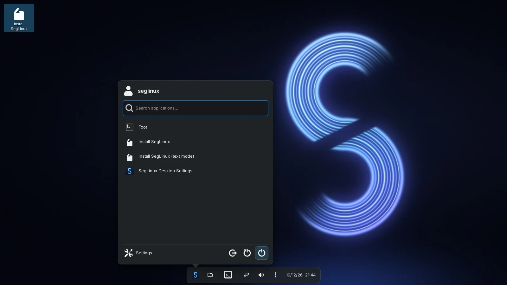
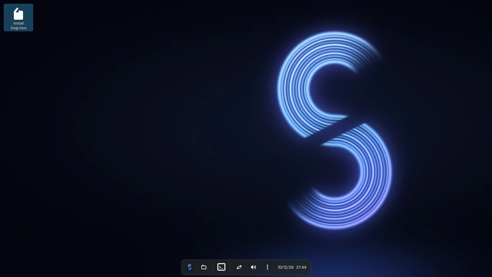
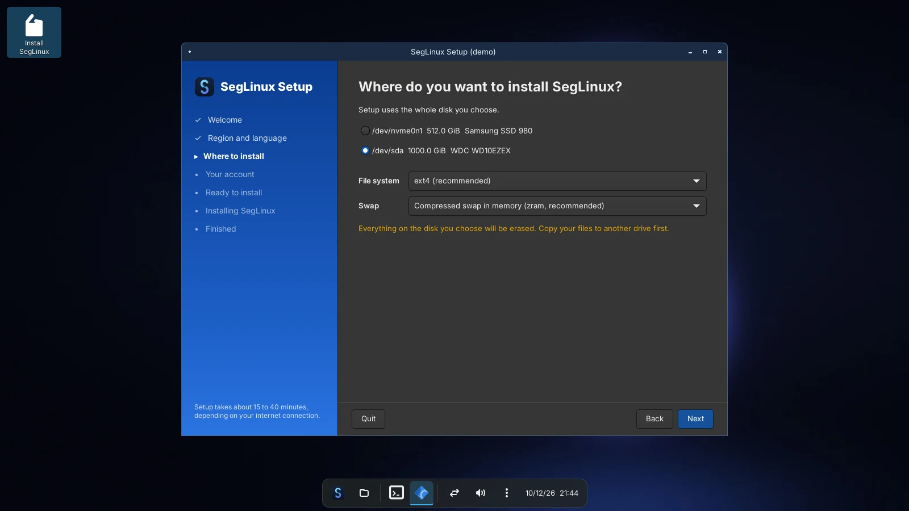
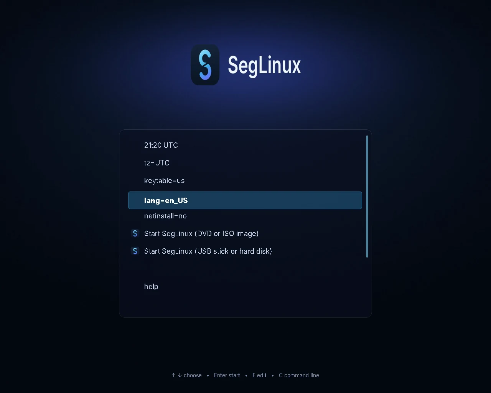
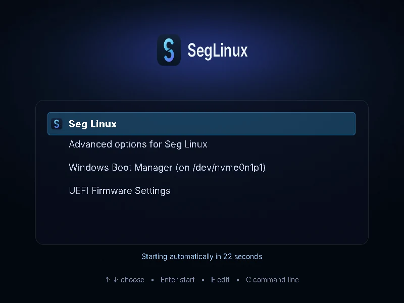

<p align="center">
  
</p>

<h1 align="center">SegLinux</h1>

<p align="center">
  <b>Lightweight Linux for gamers.</b><br>
  Installs, looks and plays like Windows. No systemd. Tools written in Rust.
</p>

<p align="center">
  <a href="https://github.com/SegMind25/SegLinux/releases">Download the ISO</a> ·
  <a href="docs/building.md">Build it yourself</a>
</p>



**SegLinux** is a lightweight Linux distribution for gaming, without
systemd: a desktop that looks, installs and behaves like Windows, runs
Windows games and programs, and is tuned for low latency. Its own tools are
written in Rust.

## Screenshots

| | |
|---|---|
|  |  |
| The desktop: wallpaper, desktop icons and the floating dock (Rust, GTK 4, labwc) | Setup, the graphical installer, in the live session |
|  |  |
| The boot menu of the DVD / USB stick | The boot menu of an installed system, next to Windows |

Screenshots of the Lite live session; the full edition adds Dolphin, Brave,
Steam, Lutris and the other pinned applications to the dock.

## Download

ISO images are on the [releases page](https://github.com/SegMind25/SegLinux/releases)
and the website's download page:

| Edition | Size | What it is |
|---|---|---|
| **Lite** | 736 MB | the desktop, Setup and drivers; Setup downloads the rest (Steam, Wine, ...) while it installs, so it needs an internet connection |
| **Full** | 2.8 GB, in two parts | everything on the image, for installing offline |

Write the ISO to a USB stick (`sudo dd if=seglinux-....iso of=/dev/sdX bs=4M status=progress oflag=sync`,
or Ventoy, or Rufus in DD mode), disable Secure Boot and boot from it. Join a
full edition's parts first: `cat seglinux-*.iso.part* > seglinux.iso`.

## Update

Installed once, SegLinux stays current without a new ISO:

```sh
sudo seglinux-update
```

This updates the system's packages, Brave, and SegLinux's own desktop and tools, all
signature-checked, from the same builds as the ISOs. A system installed from an
older ISO gets the command once with the two lines in
[docs/updating.md](docs/updating.md#systems-installed-before-seglinux-update).

* **Installs like Windows.** The ISO is built the way a Windows ISO is (see
  [how a Windows ISO works](docs/windows-iso-anatomy.md)): a live image
  plays the role of WinPE, a squashfs system image plays `install.wim`, and
  `seglinux-setup` plays `setup.exe`. It runs the same configuration passes
  (windowsPE, offlineServicing, specialize, oobeSystem, SetupComplete) and
  reads `autounattend.toml`, the counterpart of `autounattend.xml`. In the
  live session **Install SegLinux** opens a graphical GTK 4 Setup wizard
  (a text-mode one is in the menu too).
* **Lightweight, Plasma-like desktop in Rust.** Wallpaper and desktop icons,
  a floating dock with Start menu, one icon per application, tray and clock,
  written in Rust (GTK 4) on the labwc Wayland compositor, and the default
  session; KDE Plasma remains available as a fallback. The sign-in screen
  is SegLinux's own too (Rust, on greetd, in place of SDDM). Its Settings app
  (Super+I) customizes the theme and accent, wallpaper, dock, clock, windows,
  workspaces, keyboard, mouse, touchpad and games, applied instantly.
  Familiar applications by default: Dolphin for files, Brave for the web,
  kitty as the terminal (File Explorer → Dolphin, Store → Discover, ...).
* **Built for gaming.** linux-zen kernel, Steam with Proton, Lutris,
  GameMode, MangoHud and gamescope; a Steam "Gaming Mode" session; variable
  refresh rate and tearing for fullscreen games; zram swap, NTSYNC, I/O
  scheduler and sysctl tuning; NVIDIA's driver installed automatically on
  GeForce GTX 16/RTX cards. See [docs/gaming.md](docs/gaming.md).
* **Runs Windows programs.** Double-click an `.exe`, `.msi`, `.lnk` or
  `.bat`, or type `./setup.exe`: `segrun` inspects the program, prepares a
  Wine prefix (with DXVK/VKD3D-Proton when the program uses Direct3D) and
  starts it, under GameMode when it is a game.
* **Fast, systemd-free base.** OpenRC by default (parallel boot), or runit
  or dinit; rolling release.

## Website

`site/` is the project's website: features, screenshots and the download
page, which lists every ISO image of the releases. It is deployed on
[Vercel](https://vercel.com): `vercel.json` runs `site/build.py`, which
assembles the pages, the screenshots and the list of releases into `site/_site`
on Vercel. The explicit `website` service serves all public paths under `/`.
The Rust crates are Linux applications, not web backends, and are not deployed
as services. No internal services or service bindings are needed.

To deploy it:

1. On Vercel, **Add New → Project**, import this repository and keep the
   root directory `./`. Use the service configuration in `vercel.json`: it
   declares only `website`, rooted at `site/`, with framework "Other". Do not
   add the auto-detected Rust applications. Commit and push this configuration
   to the branch you import before deploying.
2. While the repository is private, add the environment variable
   `GH_TOKEN`: a GitHub token that can read this repository's contents
   (a fine-grained token with *Contents: read-only*). Without it the
   download page cannot list the releases.
3. So that each new ISO appears without waiting for the next commit:
   in the Vercel project, **Settings → Git → Deploy Hooks**, create a hook
   for `main`, and add its URL to this repository as the Actions secret
   `VERCEL_DEPLOY_HOOK`. The ISO workflow calls it after publishing.

The `/download` page provides direct ISO, split-part and checksum links; visitors
do not need to open the GitHub releases page. The files are hosted by GitHub.
For split Full images, `site/download-full.py` downloads the pieces into one ISO
and verifies its checksum. The website also renders `docs/*.md` at `/docs/`.

The page also refreshes the list from GitHub in the visitor's browser,
which works once the repository is public. Release files of a private
repository cannot be downloaded by other people: make the repository
public before sharing the site.

To preview it locally:

```sh
python3 -m pip install -r site/build-requirements.txt
python3 site/build.py --out _site   # GH_TOKEN=... lists the releases of a private repository
python3 -m http.server -d _site 8000
```

## Repository layout

```
crates/
  seglinux-shell/     Rust/GTK4 desktop, launcher, taskbar, settings and Wayland integration
  seglinux-pe/        Windows file identification: PE headers, imports, .NET,
                      installer frameworks, MSI, shortcuts (no dependencies)
  seglinux-core/      commands, XDG paths, offline service management (OpenRC/dinit/runit/s6)
  segrun/             the Windows program launcher
  seglinux-setup/     the installer: answer files, planning, execution, text-mode wizard
  seglinux-installer/ the graphical Setup wizard (GTK 4), which runs seglinux-setup
site/                 the website (deployed on Vercel)
data/                 defaults installed by the seglinux package (Plasma layout,
                      file associations, binfmt, NTSYNC, sysctl, branding)
packaging/seglinux/   PKGBUILD for the seglinux package
iso/
  build.sh            builds the ISO (container or native Artix)
  Containerfile       Artix build environment
  iso-profiles/       artools profiles: common.yaml, seglinux/ (full) and
                      seglinux-lite/ (small image), with their overlays
  pacman.conf.d/      pacman configuration used by buildiso
  scripts/            build and package-check scripts
docs/                 design notes and guides
```

## Build the ISO

```sh
./iso/build.sh                 # OpenRC + linux-zen (recommended)
./iso/build.sh -i runit        # or runit / dinit; -k linux for the stock kernel
./iso/build.sh --lite          # Lite edition: smaller image, Setup downloads the apps
```

Runs in a privileged Artix container (docker or podman) on any Linux host
and writes `iso/out/seglinux-*.iso`. The Lite edition boots the same Rust
desktop from a much smaller image and installs the same system, downloading
Wine, Steam, Brave and the drivers during Setup (so it needs internet to
install). See [docs/building.md](docs/building.md)
for step-by-step instructions for your PC, native builds, customisation and
testing in QEMU. Ready-made ISOs are built by the **ISO** workflow and
published under Releases.

## Preview the Rust desktop

With GTK4 and gtk4-layer-shell development libraries installed:

```sh
cargo run -p seglinux-shell -- --preview --wallpaper "$PWD/data/artwork/seglinux-dark.jpg"
```

The preview opens a regular window and follows changes made in Settings
(`cargo run -p seglinux-shell -- --settings`). The packaged **SegLinux (Rust)** session
uses labwc and a real Wayland panel with running-window buttons. See
[the desktop guide](docs/desktop.md) for shortcuts, configuration and limitations.

## Use the tools

```sh
cargo build --release

# What is this file, and how would SegLinux run it?
target/release/segrun info setup.exe
target/release/segrun run --dry-run setup.exe

# Install SegLinux (in the live session)
seglinux-installer                               # graphical wizard
target/release/seglinux-installer --demo         # try the wizard anywhere; installs nothing
sudo seglinux-setup                              # text-mode wizard
seglinux-setup install --unattend                # find autounattend.toml and install
seglinux-setup plan --unattend answer.toml       # dry run: every command and file
seglinux-setup validate answer.toml
```

* [Updating SegLinux](docs/updating.md)
* [Running Windows programs](docs/running-windows-apps.md)
* [Unattended installation](docs/unattended-install.md)
* [How a Windows ISO works](docs/windows-iso-anatomy.md) and
  [how SegLinux maps it](docs/windows-to-seglinux.md)

## Development

```sh
cargo fmt --all --check
cargo clippy --all-targets -- -D warnings
cargo test
shellcheck iso/build.sh iso/scripts/*.sh
iso/scripts/check-packages.sh -i openrc     # on Artix / in the build container
```

## Status

The Rust installer, Windows launcher and desktop have 163 unit tests; CI also
runs the Settings window under Xvfb (it applies, rejects invalid input and
keeps hand-edited files), the Start menu (favorites, categories, search, new
applications) and pinning, the website's downloader tests and a browser
regression test of the website. The Rust desktop is young, not a
feature-complete KDE replacement; its idle footprint (compositor, desktop and
D-Bus) is about 56 to 59 MB of proportional memory (see
[the desktop guide](docs/desktop.md#resource-use)). The installer's plan
is tested end to end in dry-run form, and its file and service actions are
tested against temporary directories; the disk-writing steps need a real
or virtual machine. The ISO profile follows artools 0.39+'s format. CI
checks every package name against the Artix repositories, and the ISO
workflow builds the image. Before installing on real hardware, try a build
in a VM (see [docs/building.md](docs/building.md#testing-in-qemu)).

SegLinux does not include any Microsoft software. Windows programs run with
Wine and Proton, so programs that need Windows kernel drivers (for example
most anti-cheat systems) do not work.

## Credits

SegLinux is built from the packages of [Artix Linux](https://artixlinux.org)
and Arch Linux, with Artix's ISO tools (artools). It is an independent
project with its own name and artwork, not affiliated with or endorsed by
either. The boot menu font is made from [Inter](https://rsms.me/inter/)
(SIL Open Font License 1.1).

No license has been chosen for this repository yet.
