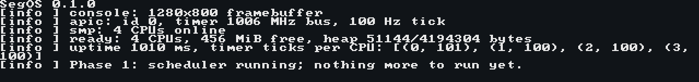
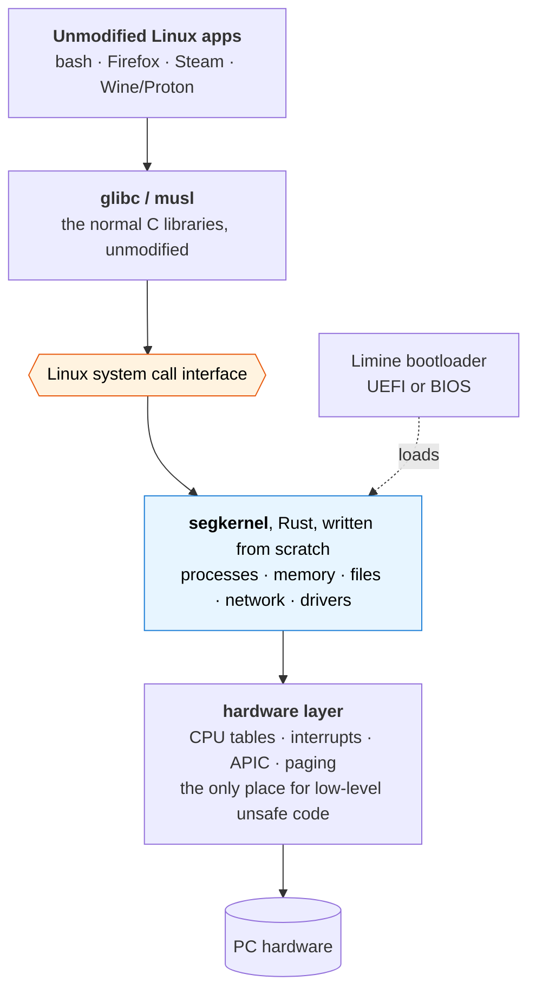
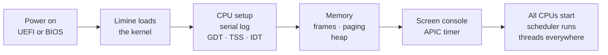
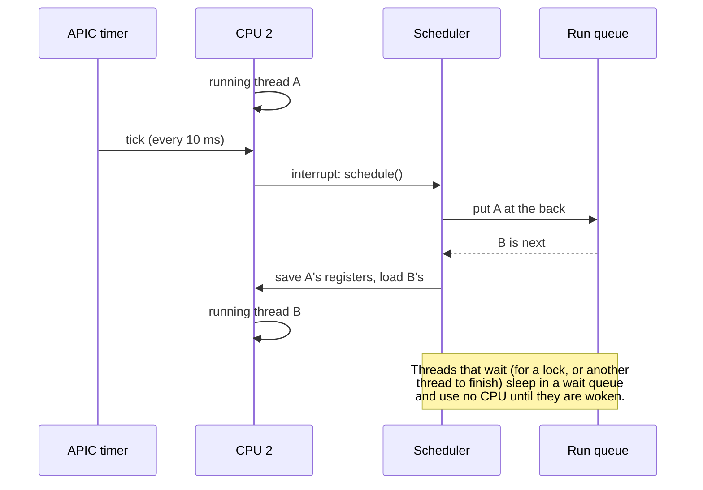
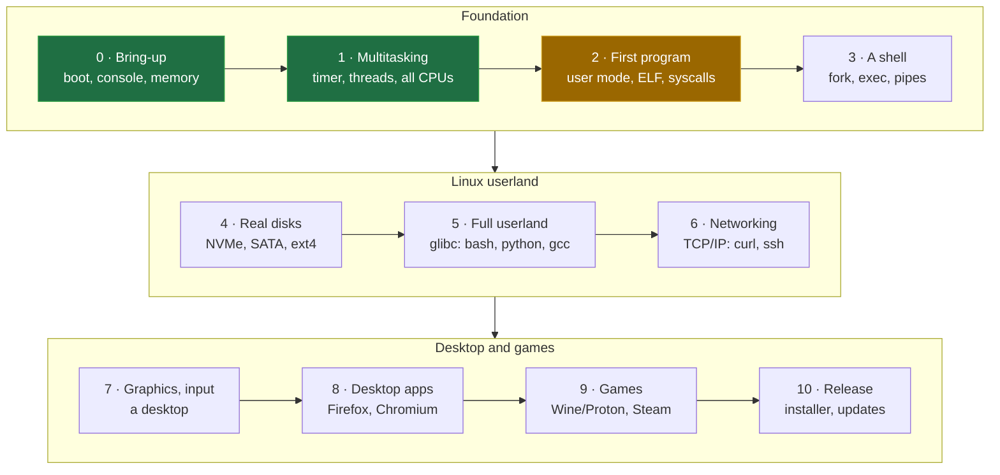
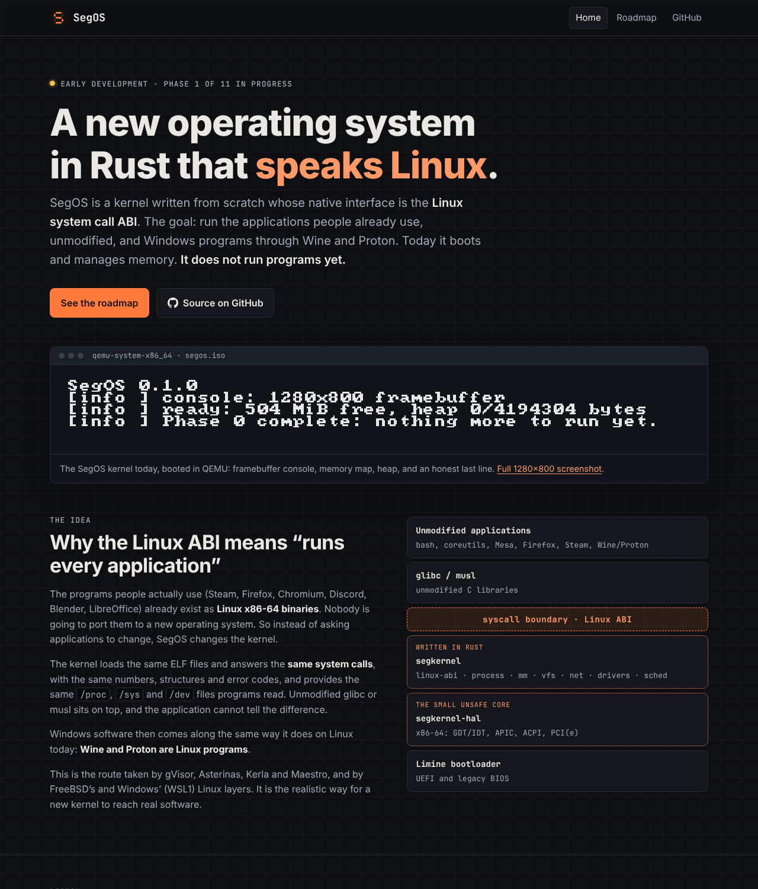

# SegOS

An operating system written from scratch in Rust, aiming to run **unmodified
Linux applications** (and, through Wine/Proton, Windows ones) by implementing
the Linux system call interface in a new kernel.

Status: **Phase 1 (multitasking) done**. The kernel boots on UEFI and BIOS,
prints to the serial port and the screen, handles CPU exceptions, manages
physical memory, page tables and a kernel heap, starts every CPU, and runs
kernel threads on all of them with a preemptive scheduler. It does not run
programs yet; that is Phase 2.

The whole roadmap, from here to Steam: [docs/plan.md](docs/plan.md).



*The kernel today, booted in QEMU: all 4 CPUs started, each timer ticking
100 times a second, threads scheduled across them.*

## How SegOS works

### The idea: speak Linux, run everything

Steam, Firefox, Discord, Blender and Wine are already built as Linux
programs. Nobody will rewrite them for a new OS, so SegOS does the opposite:
its kernel answers the **same system calls as Linux** (same numbers, same
data structures, same error codes) and provides the same `/proc`, `/sys` and
`/dev` files. A program cannot tell it is not on Linux, so it runs
unmodified. Windows games come along through Wine and Proton, which are
Linux programs themselves.



### What happens when it boots



Every step logs to the serial port, so if something fails early you still
see how far it got. A crash prints the faulting address, all registers and
a backtrace.

### How it runs many threads at once

Every CPU has a timer that fires 100 times a second. Each tick, the
scheduler may take the CPU from the running thread and give it to the next
one waiting in line. This is preemption: a thread that never stops cannot
freeze the system.



### Where things live in memory

| Virtual address | What |
|---|---|
| `0xffff_8000_0000_0000` | all physical memory, mapped directly (from Limine) |
| `0xffff_c000_0000_0000` | kernel heap: starts at 4 MiB, grows on demand |
| `0xffff_d800_0000_0000` | kernel thread stacks, 64 KiB each, with an unmapped guard page below |
| `0xffff_e000_0000_0000` | device registers (local APIC) |
| `0xffff_ffff_8000_0000` | the kernel itself |

The lower half (below `0x0000_8000_0000_0000`) is reserved for programs,
from Phase 2.

## The plan

Eleven phases. Each one ends with a demo that has to pass in QEMU and in CI
before the next starts. The goal at the end: install SegOS like any OS, then
install Steam and play.



Green is done, amber is next.

How progress is measured: small test programs whose output is recorded on
real Linux and compared on SegOS; a published table of which Linux system
calls work; and a ladder of real applications run in CI, from BusyBox up to
Steam.

Honest expectation: a working shell within months, a desktop with a browser
in 2 to 3 years, games after that. Drivers for real graphics cards are the
hardest part, as they were for every new OS. The details, phase by phase,
are in [docs/plan.md](docs/plan.md).

## The website

The project site (`site/`, deployed by Vercel) explains the project and
tracks the roadmap.



## Build and run

Needs Rust (the version is pinned in `rust-toolchain.toml`), QEMU, xorriso,
git, make, a C compiler and OVMF. On Debian/Ubuntu:

```bash
sudo apt install qemu-system-x86 xorriso ovmf build-essential git
```

```bash
cargo xtask run          # build the ISO and boot it in QEMU (UEFI)
```

```bash
cargo xtask run --bios   # legacy BIOS boot
```

```bash
cargo xtask test         # in-kernel tests, in QEMU
```

```bash
cargo xtask image        # target/segos.iso, bootable from USB or DVD
```

The first build downloads the [Limine](https://github.com/limine-bootloader/limine)
bootloader into `target/limine`.

## Layout

| Path | What |
|---|---|
| `kernel/src/hal/` | x86-64: serial, GDT/TSS, IDT and the trap path, local APIC and timer, per-CPU data, starting CPUs |
| `kernel/src/mm/` | frame allocator, page tables, kernel heap |
| `kernel/src/task/` | kernel threads, scheduler and context switch, wait queues |
| `kernel/src/sync.rs` | interrupt-safe spinlock, sleeping mutex |
| `kernel/src/time.rs` | uptime and sleeping |
| `kernel/src/console.rs` | framebuffer text console and kernel log |
| `kernel/src/limine.rs` | boot protocol requests |
| `kernel/src/ktest.rs` | in-kernel tests |
| `xtask/` | build tool: kernel, ISO, QEMU |
| `image/` | bootloader configuration |
| `site/` | the website, deployed by Vercel (`vercel.json`) |

Subsystems become their own crates once they grow (see the plan).

## Licence

MIT or Apache-2.0, at your option.

The previous project in this repository, SegLinux (a Linux distribution),
remains on the `main` branch.
