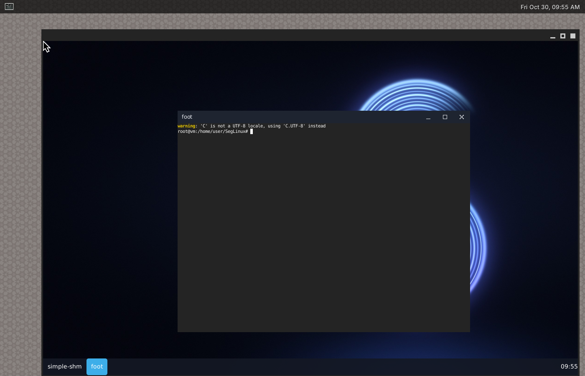

# seglinux-compositor

SegLinux's own Wayland compositor, written in Rust on
[Smithay](https://github.com/Smithay/smithay) (`crates/seglinux-compositor`).
The **SegLinux** session runs on it. If it cannot start (an error within
its first seconds), the same desktop comes up on labwc; **SegLinux (labwc)**
on the sign-in screen always uses labwc.



*Taken by the compositor itself (grim), running in a window, with Waybar
standing in for the SegLinux dock (the same two protocols: layer-shell and
foreign-toplevel); the terminal with the white page is an X11 application.*

## What works

- Application windows (xdg-shell): placed in the middle of the screen,
  focus on click, move and resize from the title bar, Super+drag moves a
  window from anywhere in it; maximize, fullscreen, minimize, snap to the
  left or right half.
- The SegLinux desktop's wallpaper, dock and menus (wlr-layer-shell), with
  windows kept out of the dock's space; the dock's open windows
  (wlr-foreign-toplevel): click to switch, minimize or restore, close, and
  show the desktop.
- Title bars for applications that ask for them (Qt and KDE applications,
  foot): the title, then minimize, maximize and close on the right; drag the
  bar to move the window (a maximized one comes back to its size). GTK
  applications draw their own.
- The Start menu and other panels that take the keyboard (wlr-layer-shell
  keyboard interactivity): focused when they open, or on a click; the
  window in front gets the keyboard back when they close.
- X11 applications through XWayland (Steam, Wine and Proton games, older
  programs): their windows are placed, focused, maximized and listed like
  any other, with a SegLinux title bar when they do not draw their own;
  their menus and tooltips appear where they ask. The desktop starts once
  XWayland is ready, so everything opened from it finds `$DISPLAY`. X11
  windows can be resized from the borders they draw (Steam's).
- Screenshots (wlr-screencopy: grim, the Print key, Super+Shift+S for an
  area) and the lock screen (ext-session-lock: swaylock, Super+L); while
  locked only the lock screen is shown and no key combination works except
  switching terminals.
- Games and applications: the pointer is held by games for mouse look
  (relative-pointer, pointer-constraints; Wayland games and X11 ones
  through XWayland), focus requests (xdg-activation: a link from a chat
  brings the browser forward), sharp text at 125 % or 150 % (fractional
  scale), portal dialogs over their application (xdg-foreign).
- Screen sharing (xdg-desktop-portal-wlr: Discord/Vesktop, OBS, browsers,
  wf-recorder): a shared screen is only copied again where it changed, and
  not at all while nothing moves.
- Your SegLinux Settings (Super+I) apply here too, read from the same
  `~/.config/seglinux/shell.toml` as on labwc: keyboard layouts and the key
  that switches them, key repeat, mouse speed and acceleration, natural
  scrolling, tap to click, typing turns off the touchpad, left-handed,
  focus follows the mouse, and the number of workspaces. Saving in
  Settings applies them at once (it signals the compositor).
- Workspaces: Ctrl+Super+Left/Right shows the one to the left or right,
  Ctrl+Shift+Super+Left/Right moves the window there; the dock keeps
  listing every window and switches to its workspace.
- Display settings (wlr-output-management: wdisplays, which Settings opens,
  wlr-randr, kanshi): resolution and refresh rate of each screen, scale
  (also fractional, such as 1.25 or 1.5) and where screens sit next to
  each other. Windows a smaller screen would cut are moved back onto it.
- Copy and paste between all applications, X11 and Wayland, and for
  clipboard managers and `wl-copy` / `wl-paste` (wlr-data-control).
- Copy and paste (also middle-click paste), GPU buffers for games and
  OpenGL/Vulkan applications (linux-dmabuf), several screens side by side
  and plugging screens in and out, switching terminals (Ctrl+Alt+F1..F12).
- The same keys as the labwc session (below), and the same start-up: the
  session runs `/usr/share/seglinux/labwc/autostart` (sound, the password
  agent, the desktop).

- Screens: turned off and on from the display settings (the windows move
  to the other screens; the last one stays on), their picture switched off
  by power management (wlopm, swayidle; any key or mouse movement brings it
  back), adaptive sync (FreeSync, G-Sync Compatible) while a game or video
  is fullscreen, or always, or never (`adaptive_sync`, or per screen in the
  display settings).
- Idle: swayidle and other idle tools are told when nobody uses the
  computer (ext-idle-notify); video players and browsers playing a video
  keep it awake (idle-inhibit). The SegLinux session itself turns nothing
  off, as on labwc.
- Touch screens: taps, swipes and several fingers go to the application;
  a tap on a title bar's buttons works. Touches land on the built-in
  screen (eDP, LVDS, DSI), else the first.

Not yet: tearing (immediate frames for games, beyond adaptive sync):
Smithay 0.7, the newest, cannot flip pages asynchronously. Games that want
it can use **SegLinux (labwc)** or the Gaming Mode session.

## Settings

`~/.config/seglinux/compositor.toml`; every key is optional. Super+Shift+R
reads it again.

```toml
# Replaces the default start-up; keep the first entry for the desktop.
autostart = ["sh /usr/share/seglinux/labwc/autostart", "nm-applet"]
background = "#0b1220"
focus_follows_mouse = false
adaptive_sync = "fullscreen"   # "on", "off"

[keyboard]
layout = "us,ara"
options = "grp:alt_shift_toggle"
repeat_delay = 300
repeat_rate = 30

[binds]
"Super+Return" = "spawn foot"
"Super+q" = "close"
"Alt+Tab" = "none"          # gives Alt+Tab back to applications
```

Actions: `spawn COMMAND`, `close`, `maximize`, `fullscreen`, `minimize`,
`cycle-windows`, `snap-left`, `snap-right`, `show-desktop`,
`workspace-prev`, `workspace-next`, `send-prev`, `send-next`,
`reload-config`, `quit`, `switch-vt N`. Keys are xkb names (`Return`,
`F4`, `Print`, `XF86AudioMute`) with `Super`, `Ctrl`, `Alt` and `Shift`.

Default keys: Super+Space Start, Super+E files, Super+Return terminal,
Super+I settings, Super+L lock, Super+D desktop, Super+Left/Right snap,
Super+Up maximize, Super+Down minimize, Super+F11 fullscreen, Alt+F4 close,
Alt+Tab next window, Print / Shift+Print / Super+Shift+S screenshots,
Super+. emoji, the volume and brightness keys, Ctrl+Alt+Backspace quit.

## Trying it

**SegLinux** on the sign-in screen. CI runs it on a real (virtual) display
driver, vkms, in a virtual machine: `crates/seglinux-compositor/tests/drm-vm.sh`.
In a window of a running desktop:
`seglinux-compositor --winit`. Problems are logged with `RUST_LOG=debug`.
Should something not work, sign in to **SegLinux (labwc)**: the same
desktop on labwc.
